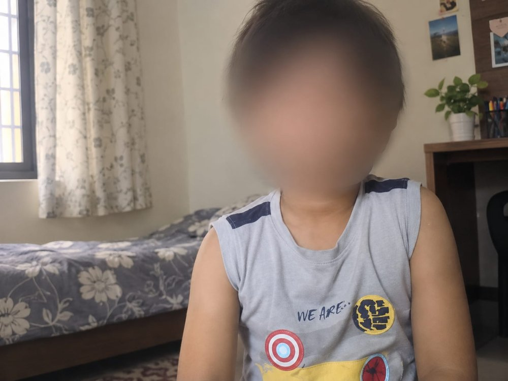

# Project Report: ESP32-CAM Web Stream

| | |
|---|---|
| **Project** | ESP32-CAM Web Stream (live video, photo capture, flash control) |
| **Author** | Munazza Hawaldar |
| **Programme** | Diploma in Electronics & Telecommunication Engineering |
| **Date** | October 2026 |
| **Platform** | AI Thinker ESP32-CAM with ESP32-CAM-MB programmer |
| **Language / IDE** | C/C++ (Arduino framework), Arduino IDE |

## 1. Objective

To build a low-cost WiFi camera that streams live video to any web browser on the same network, captures photos on demand, and controls the onboard flash LED, using only the ESP32-CAM board and no extra components.

## 2. Result

*Sample photo. The face has been blurred for privacy.*

## 3. Hardware used

| Component | Purpose |
|---|---|
| AI Thinker ESP32-CAM (OV2640 camera) | Camera, WiFi and processing |
| ESP32-CAM-MB base board (CH340) | USB programming and power |
| Micro-USB data cable | Upload code and supply 5V |
| WiFi network / mobile hotspot (2.4 GHz) | Network connection |

## 4. Software used

- Arduino IDE with the Espressif ESP32 board package
- Libraries bundled with the package: `esp_camera`, `WiFi`, `esp_http_server`
- Web page written in HTML, CSS and JavaScript, stored inside the sketch

## 5. Working principle

1. The ESP32 initialises the OV2640 camera in JPEG mode (VGA 640x480 when PSRAM is available).
2. It connects to the WiFi network and prints its IP address on the Serial Monitor.
3. Two HTTP servers start on the board:
   - **Port 80:** serves the web page, the `/capture` photo endpoint and the `/flash` LED control.
   - **Port 81:** serves the continuous MJPEG video stream at `/stream`.
4. The browser opens the page, shows the stream, and uses buttons to take a photo or switch the flash LED (GPIO 4) on and off.

Keeping the stream on its own server means a long-running video request does not block the capture and flash requests.

## 6. Features

- Live MJPEG video stream in the browser
- One-click photo capture with preview and download
- Flash LED ON/OFF control from the web page
- WiFi power-save disabled and automatic reconnect for a steadier connection
- Works with only the ESP32-CAM board, no extra parts

## 7. Problems faced and how they were solved

| Problem | Solution |
|---|---|
| ESP32 repeatedly connected and disconnected from the mobile hotspot | Used a 2.4 GHz hotspot, turned WiFi power-save off, enabled auto-reconnect and a reconnect check in `loop()` |
| Possible resets from low power | Powered the board from a direct USB port instead of a hub |
| Finding the board's IP address | Read it from the Serial Monitor at 115200 baud after pressing RST |

## 8. Learning outcomes

- Configuring and using a camera module on a microcontroller
- Running an embedded HTTP server and serving a web page from the ESP32
- Streaming MJPEG video over WiFi
- Controlling GPIO from a web interface
- Debugging WiFi and power issues on embedded hardware

## 9. Future scope

- Motion detection with Telegram photo alerts
- Face detection and recognition
- Adding a DHT11 sensor to show temperature and humidity on the page
- Saving photos to an SD card

## 10. Conclusion

The project successfully turns an ESP32-CAM into a standalone WiFi camera that can be viewed and controlled from any browser. It is a practical introduction to embedded systems, IoT networking and camera interfacing.

## Source code

See `esp32cam_web_stream.ino` in this repository.
